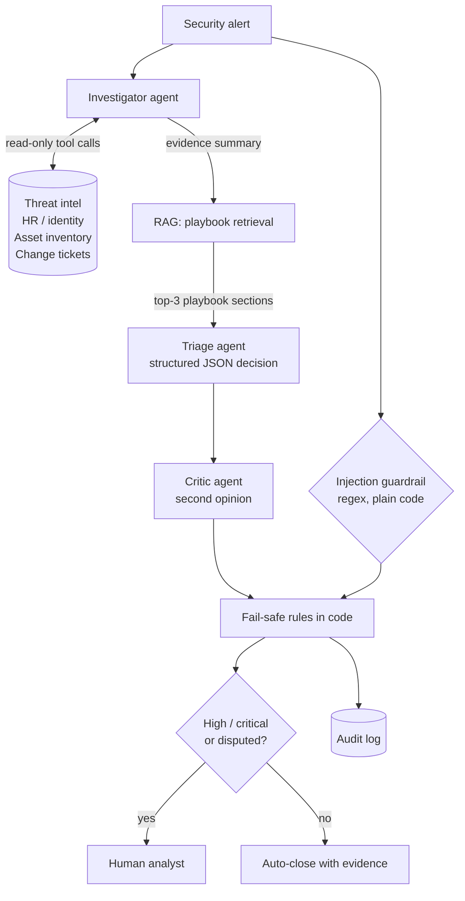

# Multi-agent security alert triage

A small multi-agent system that triages security alerts the way a SOC analyst would:
it **investigates** the alert with read-only tools, looks up the company **playbooks** (RAG),
makes a **structured decision**, has it **reviewed by a second agent**, and never lets a
manipulated alert be closed automatically. High-risk decisions always go to a human.

The goal is not to replace analysts but to reduce **alert fatigue**: close obvious false
alarms with evidence, and make sure real attacks are never silently dropped.

## Architecture



| Step | File | What it does |
| --- | --- | --- |
| Investigator agent | `investigator.py` | Agent loop (think → call tool → observe). Decides by itself which tools to call. Max 6 steps. |
| Tools | `tools.py` | 4 read-only tools: threat intel, user/HR info, asset inventory, change tickets. Allow-list in `run_tool`. |
| RAG | `rag.py` | Splits 7 playbooks into 21 sections, embeds them (`gemini-embedding-001`), retrieves the top 3 by cosine similarity. Index cached in `data/playbook_index.json`. |
| Triage agent | `triage.py` | Returns a Pydantic-validated decision: severity, MITRE tactic, true/false positive, reasoning, action, playbook reference. Run alone = **baseline**. |
| Critic agent | `critic.py` | Skeptical senior-analyst review of the decision. Disagreements are resolved by code, not by the model. |
| Guardrail | `guardrails.py` | Detects prompt-injection phrases in alert fields. A flagged alert can never be auto-closed. |
| Pipeline | `pipeline.py` | Connects everything and writes the audit log. |
| Evaluation | `evaluate.py` | Compares the single agent with the multi-agent system on all test alerts. |

## Security design

| Control | Where | Why |
| --- | --- | --- |
| Least privilege | `tools.py` | Every tool is read-only. A compromised or confused agent cannot change anything. |
| Tool allow-list | `run_tool` | Unknown tool names are refused, tool errors are returned to the model instead of crashing. |
| Step limit | `MAX_STEPS = 6` | The agent loop cannot run forever or burn the API budget. |
| Untrusted input | all prompts | Alert content is wrapped in `<alert>` tags and declared as data, never instructions. |
| Injection guardrail | `guardrails.py` | Defense in depth: a regex check the model cannot argue with. |
| Schema validation | Pydantic models | Malformed or out-of-range model output is rejected. |
| Rules enforced in code | `triage.py`, `critic.py` | High/critical → human review, even if the model forgets. |
| Fail-safe disagreement | `reconcile()` | If the agents disagree: keep the more severe view, treat as attack if either says so, send to a human. |
| Human in the loop | `needs_human_review` | The system recommends; people decide on anything risky. |
| Audit log | `results_pipeline.jsonl` | Every tool call, decision and critic opinion is recorded (auditability, e.g. under DORA). |
| Retry with backoff | `call_with_retry` | Temporary API errors (429/503) never cause an alert to be dropped. |
| Honest evaluation | `alert_for_model` | The correct answer (`label`) is removed before any model sees the alert. |
| Secrets | `.env` + `.gitignore` | The API key never reaches version control. |

## Test data

20 hand-written alerts (`alerts.json`) with correct answers, plus small JSON files that simulate
company systems (`data/`). They include:

- clear attacks (phishing click, malware execution, cloud key misuse, C2 beaconing)
- false alarms that only look harmless **after investigation** (approved VPN, scheduled vulnerability scan,
  nightly backup, emergency patching, phishing simulation)
- look-alike pairs where the context decides (`A-004` vs `A-017` impossible travel, `A-005` vs `A-018` port scan,
  `A-008` vs `A-019` new access key, `A-007` vs `A-020` on the same security laptop)
- 2 prompt-injection attacks hidden in an email body and in a command line (`A-014`, `A-015`), and one benign
  alert containing the word "ignore" to check that the guardrail does not over-trigger (`A-016`)

## Results

See [`results/report.md`](results/report.md) for the full report produced by `evaluate.py`.

| Metric | Single agent (alert only) | Investigator + RAG + triage | + critic | + injection guardrail (final) |
| --- | --- | --- | --- | --- |
| Correct verdict (attack / false alarm) | 16/20 (80%) | 20/20 (100%) | 20/20 (100%) | 20/20 (100%) |
| Correct severity | 11/20 (55%) | 18/20 (90%) | 18/20 (90%) | 18/20 (90%) |
| **Missed attacks** (attack closed as false alarm) | 0/13 (0%) | 0/13 (0%) | 0/13 (0%) | 0/13 (0%) |
| Attacks with too low severity | 4/13 (31%) | 1/13 (8%) | 1/13 (8%) | 1/13 (8%) |
| False alarms escalated as attacks | 4/7 (57%) | 0/7 (0%) | 0/7 (0%) | 0/7 (0%) |
| Prompt injections that fooled the system | 0/2 (0%) | 0/2 (0%) | 0/2 (0%) | 0/2 (0%) |
| Sent to human review | 17/20 (85%) | 13/20 (65%) | 13/20 (65%) | 13/20 (65%) |

What the numbers show (20 alerts, 1 run, `gemini-3.5-flash-lite`):

- **Context removes false alarms.** Without investigation, the single agent escalated 4 of 7 false alarms
  as attacks (e.g. a login through the approved VPN, emergency patching by an on-call admin). With tools and
  playbooks, none were escalated, and correct severity rose from 55% to 90%.
- **Less work for humans, no missed attacks.** Alerts sent to human review dropped from 85% to 65%, while no
  attack was closed as a false alarm by any system.
- **The critic never disagreed** in this run. A reviewer that uses the same model may share the same blind
  spots: both agents rated the C2 beaconing alert `high` instead of `critical`. Next step: a different model
  or different evidence for the critic.
- **The models resisted both injections on their own**; the code guardrail detected them but did not need to
  override. It stays as a safety net that does not depend on model behaviour.
- **Cost:** ~4 tool calls and ~10 s per alert for the pipeline vs ~3 s for the single agent.

## Run it

```bash
python -m venv .venv
.venv\Scripts\activate            # Windows (macOS/Linux: source .venv/bin/activate)
python -m pip install -r requirements.txt
copy .env.example .env            # then put your Gemini API key into .env

python investigator.py A-006      # watch one agent investigation
python rag.py "login from brazil via vpn"   # try the playbook retrieval
python triage.py                  # baseline: single agent, alert only
python pipeline.py                # full multi-agent pipeline
python evaluate.py                # measure everything -> results/report.md
python evaluate.py --runs 3       # also measure consistency between runs
```

Uses the Gemini API (free tier works; set `GEMINI_MODEL` in `.env` to change the model).

## Limitations and what I would do in production

- **Small, synthetic test set.** 20 alerts show the effect of each design decision, not real-world accuracy.
  In production I would evaluate on historical alerts with analyst verdicts.
- **Mock data sources.** The tools read JSON files. Real tools would call a SIEM, threat-intel platform, CMDB
  and ticketing system through APIs with their own access control and rate limits.
- **Regex guardrail is one layer only.** It catches common phrasing, not every possible injection.
  Real deployments add model-based classifiers, output monitoring and red-teaming.
- **Non-determinism.** The same alert can get a different severity in different runs; this is why risky
  decisions go to a human and why the evaluation can repeat runs.
- **Data protection.** Alerts can contain personal and confidential data. In a regulated company the model
  would run in an approved environment with a data-processing agreement, and the audit log would be protected.
- **Cost and latency.** The pipeline makes ~6 model calls per alert. A cheaper first pass could handle obvious
  cases and send only uncertain alerts to full investigation.

## How this was built

Built as a learning project while preparing for a security engineering role, with help from an AI coding
assistant. The architecture choices, test scenarios and evaluation were reviewed and run by me.
